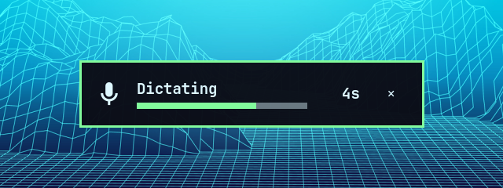

# Luddite Voice OSD

Compact recording and processing windows for local [Voxtype](https://github.com/peteonrails/voxtype)
dictation on Omarchy Quattro. The popup follows the active Omarchy theme using
the shell's actual `Commons` and `Ui` components. Its surface follows the system
volume OSD: the same padding, border, rounding, large icon, bold readout font
and bottom offset. Width is measured from the current font and capped to the
screen's logical width; larger fonts can grow the height to keep content clear.
Theme spacing, system fonts, display text size and compositor scaling apply
through the shared shell tokens.



During recording it shows a real input-level meter, elapsed time and a quiet-input
warning. The recording icon uses the same microphone/microphone-muted glyphs
as the system OSD. The unmuted icon follows the system popup text color; when
the system default microphone reports mute, the icon and “Microphone muted” label
use the theme's red/urgent color and the meter is empty. Mute status follows
the default input used by Omarchy's microphone widget, while quiet-input warnings
come from Voxtype's actual level summaries. During transcription it stays visible
with a moving processing indicator and its own elapsed time. Cancel discards the current recording or pending
transcription. Idle hides the window. Keyboard focus stays in the app receiving
your dictation.

This is the compact popup extracted from the
[Odin 2 Portal project](https://github.com/TechLuddite/omarchy-mobile-odin2/blob/main/docs/direct-dictation.md).
It works without that project's controller, hardware broker, UI bridge or larger
Voice command panel.

## Release status

Version 0.1.1 is available from
[TechLuddite/luddite-voice-osd](https://github.com/TechLuddite/luddite-voice-osd).
The user has confirmed it working on both an Omarchy desktop and laptop after
updating, including the corrected single-popup setup. The desktop was tested
with Omarchy 4.0.5 and Voxtype 1.1.1; the laptop's exact versions were not
collected. Theme switching has also been tested on the desktop. Marketplace
submission is being prepared. See [development and acceptance](docs/development.md)
for the test scope and remaining hardware-specific checks, and
[the changelog](CHANGELOG.md) for version history.

## Preview and demo


The animation shows the real plugin UI with scripted input levels and phases
on a clean desktop with matching Omarchy wallpapers.
[More theme examples and media details](docs/media/README.md).

## Requirements

- Omarchy Quattro with the Quickshell shell and its current `Commons`/`Ui` kit.
- Python 3.11 or newer; only the standard library is used.
- An already configured Voxtype daemon providing `$XDG_RUNTIME_DIR/voxtype/state`
  and `audio.sock`. The protocol is based on Voxtype 1.1.0, with basic desktop
  dictation also tested on 1.1.1; other releases need confirmation. Use the
  normal runtime paths; custom state/socket paths are currently unsupported.

Voxtype owns capture, the model, transcription and insertion. Set it up and
check its ordinary dictation flow first. This plugin installs no speech models,
changes no audio settings and starts no recording when enabled.

## Installation

Install and enable the plugin using Omarchy's plugin command, with dictation idle:

```sh
omarchy plugin add https://github.com/TechLuddite/luddite-voice-osd --enable
```

No plugin install hook or privileged helper is needed.

For a deliberate local installation, copy this directory's source files to
`~/.config/omarchy/plugins/io.github.techluddite.voice-osd/`, then run:

```sh
omarchy-shell shell rescanPlugins
omarchy plugin enable io.github.techluddite.voice-osd
```

The service starts its observer and stays hidden at idle. Existing `voxtype record`
shortcuts continue to work while the plugin is enabled. Prefer the gated commands
below for new bindings: they refuse to start when the frontend is unavailable.

Enabling the plugin automatically selects its popup on a standard Omarchy
Voxtype installation. Once the display is available and Voxtype is idle, it
saves the previous `osd.enabled` value, sets only that key to `false`, and
restarts the running `voxtype.service` to apply it. It leaves Omarchy's
`omarchy.osd` plugin enabled, so volume, brightness and other system overlays
keep working. If the stock Voxtype popup was already disabled, no configuration
change or restart is needed.

The previous value is restored when our service unloads, including normal
disable/removal and shell reloads. If it was originally unset, the key is removed
again. Other Voxtype settings and later user edits are preserved. A private
recovery receipt lives at
`${XDG_STATE_HOME:-~/.local/state}/luddite-voice-osd/voxtype-osd.json` while the
plugin owns the setting. A shell reload can restart the idle Voxtype service
as ownership changes.

Automatic switching requires Voxtype's `config get/set/unset` commands (tested
with 1.1.1), the regular user configuration file and the standard systemd user
service running `voxtype daemon`. Custom service commands, configuration paths
or linked configuration files require manual setup. If switching fails, a
desktop notification explains that setup is needed, and our recording popup
stays hidden to avoid showing both. `status` reports `osd_setup` as `waiting`,
`ready` or `manual`.

For manual setup, note your existing setting, then while Voxtype is idle:

```sh
voxtype config set osd.enabled false
systemctl --user restart voxtype.service
```

For older releases without the config command, set `[osd] enabled = false` in
`~/.config/voxtype/config.toml` and apply it using your installation's usual
restart procedure while idle. The plugin rechecks for this manual fix. A previous
Portal installation has its own `voxtype-osd` shim and managed files: migrate it
separately using its recovery record, rather than enabling two frontends.

## Updating

Finish any active dictation, then run:

```sh
omarchy plugin update io.github.techluddite.voice-osd
```

Review and confirm the update when prompted. The shell reloads the plugin;
no reboot is needed. Give the observer a few seconds to connect, then check:

```sh
omarchy-shell luddite-voice-osd status
```

`connected: true` and `osd_setup: ready` indicate that the popup is ready.
Existing Voxtype recording shortcuts continue to work. The update to 0.1.1
handles selection of this popup automatically on standard installations.

## Controls

```sh
omarchy-shell luddite-voice-osd toggle
omarchy-shell luddite-voice-osd start
omarchy-shell luddite-voice-osd stop
omarchy-shell luddite-voice-osd cancel
omarchy-shell luddite-voice-osd status
```

Toggle starts from idle or stops recording. It does nothing during processing.
For push-to-talk, bind press to `start` and release to `stop`. Commands are
serialized; a quick release waits for the start acknowledgement. `queued` means
the observer received a request, not that transcription succeeded. `status`
reports connection, phase, pending action, level and static error codes; it
contains no dictated text. Stop and Cancel do not require a healthy display.

Bindings are your choice; the plugin does not replace any shortcuts. The Cancel
button never requests keyboard focus.

## Lifecycle and privacy

The observer reads only the daemon's state and validated 16-byte level summaries.
It opens no microphone, records no audio, reads no transcript and makes no network
request. Voxtype's own capture, output and logging behavior is unchanged.

The UI observes default-microphone mute metadata through the shell's PipeWire
service without opening a capture stream or changing audio settings.

The UI and observer exchange bounded metadata and whitelisted actions over
private process pipes. A single runtime lock prevents duplicate observers.
The service launcher uses a waiting parent so Quickshell's immediate child
termination on QML destruction leaves the observer time to finish cleanup.
Socket peers must belong to the same user. If the frontend stops responding or
the active window disappears, the observer asks Voxtype to cancel. Closing the
observer's input or terminating it also cancels unfinished dictation. Cancellation
cannot retract text already inserted by Voxtype, and no userspace observer can
guarantee cleanup after forced termination such as SIGKILL.

This plugin observes the user's ordinary Voxtype daemon, including recordings
started through other shortcuts. Disabling it during dictation cancels that work.
Do so while idle:

```sh
omarchy plugin disable io.github.techluddite.voice-osd
omarchy plugin remove io.github.techluddite.voice-osd
```

The automatic setup restores only the preference it changed. If you selected
the popup manually, restore your previous `osd.enabled` value yourself. Replace
any bindings you explicitly routed here with their previous commands. Existing
models, Voxtype config and output preferences are retained.

If shutdown or restoration was interrupted, the recovery receipt remains. With
the plugin disabled and Voxtype idle, finish restoration before removing it:

```sh
python3 -I -B ~/.config/omarchy/plugins/io.github.techluddite.voice-osd/backend.py --restore-osd
```

If already removed, run the same command using `backend.py` from a checkout of
this repository. It refuses to run while another observer holds the runtime
lock. A stopped Voxtype service stays stopped. If a busy/custom service prevents
the restart, the restored preference stays on disk and the receipt is retained
until recovery can finish. Forced termination cannot guarantee immediate
restoration; it does not discard the saved preference.

## Development

```sh
python3 -B -m unittest discover -s tests -v
python3 -B tests/qml_smoke.py
python3 -B tests/qml_smoke.py --backend
python3 -B tests/qml_smoke.py --backend --osd-switch
python3 -B tests/qml_smoke.py --active-theme --output-scale 1.5 --output-width 640
```

The unit suite uses mocked commands, temporary runtime directories and private
Unix sockets. Process tests supply a fake Voxtype executable; they cannot reach
the real daemon. The QML fixture needs installed Omarchy/Quickshell, uses a
temporary HOME/runtime and synthetic metadata, and does not enable the plugin.
It launches a private headless Sway compositor with no hardware input/output
backend. Sway must be installed, or supplied with `--compositor`; an extracted
build can also use `--compositor-library-path`. The `--backend` variant runs the
real observer against a fake Voxtype executable and verifies cleanup on service
destruction. `--osd-switch` also checks preference restoration on actual QML
destruction, with service identity and restarts simulated in the private fixture.
`--active-theme` copies the current theme, shell text-size overrides
and fontconfig into the private HOME. `--output-scale` and `--output-width` exercise display
scaling and narrow logical outputs. The synthetic fixture loads the installed
system volume OSD as its comparison and checks live fonts, spacing and borders.
`--artifacts <directory>` saves recording, quiet-input, muted, processing and
reference volume PNGs, plus large-font variants.
See [the development record](docs/development.md)
for the distinction between those checks and physical dictation acceptance.

GitHub CI follows the other Luddite plugins: unit/repository checks on pushes and
PRs, then pinned Luddite Scout and marketplace security-baseline scans on main
pushes. Automatic Voxtype restart is a declared `service-management` capability;
the marketplace scanner requires human review for it. CI rejects findings and
unexpected capabilities while retaining that classification. See
[the security policy](SECURITY.md). The installed-Omarchy QML fixture is a separate local check. Hosted
results are available in
[GitHub Actions](https://github.com/TechLuddite/luddite-voice-osd/actions).

MIT. The OSD layout and microphone tracking include adaptations from Omarchy
by David Heinemeier Hansson and contributors. See the retained
[Omarchy MIT notice](licenses/omarchy-MIT.txt) and
[credits and protocol provenance](THIRD_PARTY.md).
